# From a frame to a fitted pose: the layers of the fit

This walks through every layer the analysis makes on its way to a fitted
pose, on real frames of a workspace the app shows, up to and including the
**fit stage** (`pipeline.run_fit`). It answers three questions: where the
head and the tail come from, how the midline is defined, and how the body
outline follows from it. The later stages (ambiguity flags, propagation,
the track-length pass) start from what is described here and are left out,
except where the last section uses them for contrast.

The example workspace is **2023-03-30-01** (setup nir-flv, 19,696 frames,
analysed on 2026-10-15): body model `nir-flv-labels-279` (lags 1, 4 and 16
frames at 20 fps), masks from the same network (`mask_source: body_net`),
the `fast` preset and a bootstrapped recording prior. Every figure is drawn
from that workspace's own masks and stored poses, with the network run
again on the same frames and every start of the fit refit on its own to
show what the stage normally throws away
([`scripts/fit_layers_figures.py`](../scripts/fit_layers_figures.py); see
[Reproducing the figures](#reproducing-the-figures)). The colours are the
Workspace page's: head ■ green, tail ● red, outline yellow, mask cyan, and the
same A-P colour map (green at the head through blue and purple to red at the
tail).

The five example frames:

| Name | Frame | What it shows |
|---|---|---|
| clear | 8012 | whole body in view, both ends found |
| contact | 4722 | head inside a coil, body touching itself |
| edge | 12577 | tail off camera (bottom edge) |
| open_ends | 9583 | head found, tail rejected; two starts reach the same pose |
| contact_failure | 12657 | head not found; the fit takes the wrong route (IoU 0.81) |

## The pipeline at a glance

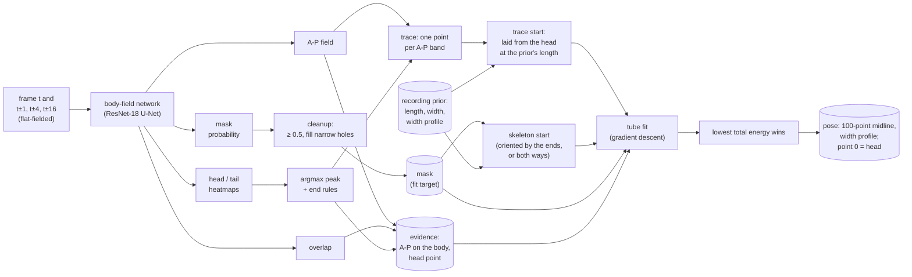

Three things to keep in mind throughout:

- **Each frame is fit on its own.** The only temporal information in the
  fit stage is the network's difference channels; nothing ties a frame's
  pose to the previous frame's.
- **Point 0 of the midline is the head, by construction.** There is no
  separate head or tail estimate in the output: the head is wherever the
  winning fit put its first point, the tail wherever it put its last.
- **The body length is fixed.** With a recording prior and a body model,
  every start is laid to the prior's length (753.6 px here) and the fit never
  changes it, so the tail is the head plus 753.6 px of body.

## 1. Network input

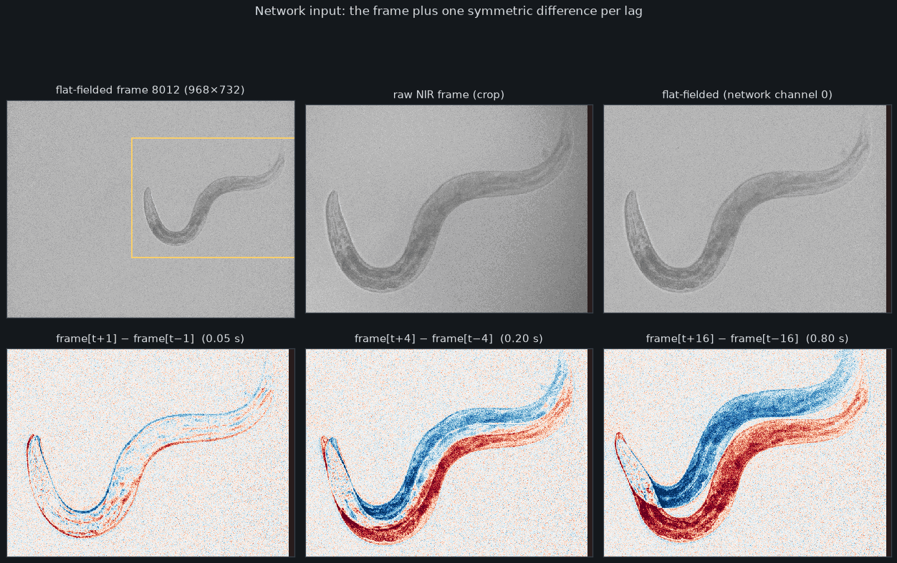

The network sees the flat-fielded frame (`flat_field.py`, a per-recording
gain and dark level) normalized like the segmenter's input, plus one channel
per lag: `frame[t+lag] − frame[t−lag]`, divided by 255
(`body_proposal.network_inputs`). The lags of this model are 1, 4 and 16
frames (0.05, 0.2 and 0.8 s). A lag reaching outside the recording gives a
zero channel. The differences are what lets the network tell head from tail
(the head moves differently from the tail) and one limb from another where
they touch.

## 2. The network's five outputs

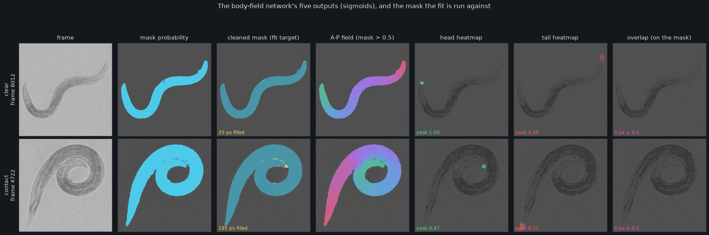

The network (`body_net.py`) returns five sigmoid maps at full resolution.
The Workspace page shows them raw under the model-output layers
(`app/network_fields.py`, over the whole frame, unmasked); the figure shows
them on the frame dimmed, the overlap only on the mask (it is trained on
mask pixels only, so its values elsewhere mean nothing, as the pink
background in the app's raw layer shows).

| Output | Trained against | What the fit stage does with it |
|---|---|---|
| `mask` | hand-labelled worm pixels (BCE + soft Dice) | thresholded and cleaned into the **mask the fit is run against** (this workspace; the default is the separate segmenter) |
| `ap` | normalized arc length of the label's fitted tube: 0 at the head, 1 at the tail (L1 on mask pixels) | the **A-P evidence term** of the fit's energy, and the **bands** the trace start follows |
| `head` | a Gaussian at the label's head (σ = ¼ body width; focal loss) | its **argmax** is the head point: it anchors the trace start, pulls the fit's first point, and orients the other starts |
| `tail` | a Gaussian at the label's tail | its **argmax** orients the other starts when the head is also found, and ends the trace when the head is not; it **never enters the energy** |
| `overlap` | pixels the label's tube covers twice (a crossing) | pixels ≥ 0.5 are **left out** of the A-P evidence and the bands |

The A-P targets come from fitting the tube model to each label's mask and
orienting it, so the network's A-P field is "where along a fitted tube this
pixel would be"; labels end their tail where the person clicked it, which is
why the fit trusts only the front half of the A-P field (sections 7 and 8).

In the contact frame the network predicts no crossing (the coil touches
itself but no part lies on top of another), and the A-P field still changes
sharply across the contact line between the inner and outer turn. That jump
is what lets the trace and the evidence pick the right turn where the mask
alone cannot.

### The mask the fit is run against

`pose_run.clean_mask`: probability ≥ 0.5, then holes narrower than 8 px are
filled (`mask_fit.fill_narrow_holes`), and every component is kept. The
filled pixels are shown yellow in the third column: a few pixels along the
clear body, 185 px at the contact, where the gap between the touching turns
closes. Over the recording, 18% of frames have filled pixels and 16% have
more than one component. This mask is the only image evidence the tube is
scored on.

## 3. Head and tail: one argmax each, then the end rules

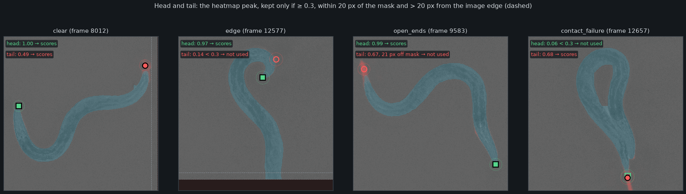

Each heatmap is reduced to **one point: its maximum** (`FieldPrediction.peak`,
a plain `argmax` over the whole frame). That point is used only if it passes
the end rules (`body_proposal._end`, `_scored`):

1. the peak value is at least **0.3** (`END_THRESHOLD`; below it the end is
   taken to be out of view),
2. it lies within **20 px of the mask** (`END_MASK_PX`, dotted circles):
   a peak farther off sits on something the cleanup removed,
3. it is more than **20 px from the image edge** (`END_BORDER_PX`, dashed
   rectangle): where the body leaves the camera the tail heatmap fires at
   the edge.

The rules bite in practice:

- **edge**: the tail is off camera and its heatmap peaks at 0.14 on the body
  near the head; it is not used.
- **open_ends**: the tail heatmap peaks at 0.67 on the real tail tip, but the
  mask stops short of the thin tip and the peak lies 21 px off it, so it is
  not used. Only the head orients this frame.
- **contact_failure**: the head lies against the body and its heatmap peaks
  at 0.06; only the tail is used. Without a head the fit has
  no anchor (section 5).

| | Head (passes the rules) | Tail (passes the rules) |
|---|---|---|
| End term of the energy: the fit's point 0 pulled toward it | yes | **no** |
| Trace start | laid **from** it, at the prior's length | ends the trace only when there is **no head** |
| Orients the other starts | when the tail passes too (`mask_fit.head_first`) | when the head passes too |

So the head is a network output that the fit follows closely, and the tail
is an **outcome**: wherever 753.6 px of body laid from the head ends. That
was a deliberate choice ([BODY_FIELDS.md, *Head-anchored body of fixed
length*](BODY_FIELDS.md#head-anchored-body-of-fixed-length)): people place the tail inconsistently when tracing labels, so
the tail heatmap and the rear half of the A-P field are the unreliable parts
of the network.

## 4. The recording prior

The prior stage (`recording_prior.py`) fits 190 frames spread over the
recording with wide bounds, keeps the whole, clean, clearly oriented ones
(16 here) and takes robust medians:

| Prior | Value | Used as |
|---|---|---|
| length | 753.6 px | **fixed length** of every start and fit (`MaskFitConfig.length_fixed`) |
| width | 44.0 px (log σ 0.05) | the starts' width; a Gaussian pull on the fit's width scale |
| width shape | 6 coefficients, tail last | the starts' width profile; a pull (weight 0.01) on the fit's |

The width profile is asymmetric (the tail tapers over a longer stretch than
the head), which used to be how the fitter told head from tail. With the
body model it is only a weak extra; the evidence decides the head.

## 5. From the A-P field to a starting midline

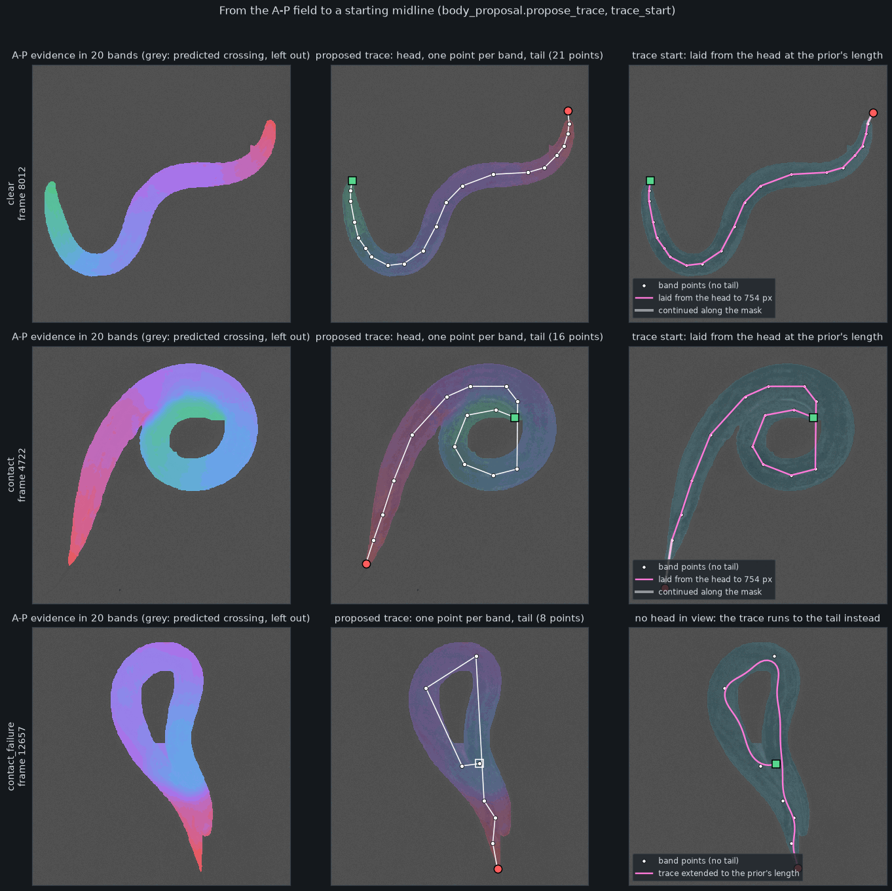

The **trace** (`body_proposal.propose_trace`) turns the A-P field into a
handful of points along the body, like a person clicking along it:

1. The A-P evidence (the field on the mask, minus predicted crossings) is cut
   into **20 bands** of equal A-P width (first column).
2. Each band's pixels split into connected patches. Patches under half the
   size of the band's largest are noise along a contact line and are
   skipped; of the rest, the walk takes the patch **nearest the previous
   point** (so it stays on the limb it is following).
3. The band's point is the patch's most central pixel (distance to the mask
   edge at least 70% of the patch maximum) nearest its centroid.
4. The trace is the head, the band points, then the tail, each end only if
   its peak is at least 0.3 and within 20 px of the mask (the image-edge
   rule is not applied here); points closer than a third of a body width to
   the previous one are dropped (middle column).

The **trace start** (`body_proposal.trace_start`, right column) then makes a
pose of it:

- **With the head** (passing all three rules of section 3): the trace is
  taken **without the tail**, trailing band points that turn back are
  dropped, and the polyline is **laid from the
  head to exactly the prior's length** (`mask_fit.lay_centerline`): cut where
  it reaches 753.6 px, or, if shorter, continued past its last band point
  along the mask's ridge (a walk on the distance transform that never runs
  back along the body; faint white in the figure), or straight off camera
  where it ends within 80 px of mask pixels on the image border.
- **Without the head** (contact_failure): the trace runs from its first band
  point to the tail and is lengthened off camera to the prior's length if it
  ends at the border. Its first point is the first band's largest patch,
  which on contact_failure lies mid-body (hollow square in the middle
  column: not a head the network found), and the start's point 0, so the
  fit's head, starts there.

The polyline is resampled to 100 points and encoded in the model's latent
(section 7), with the prior's width and width profile.

## 6. The starts

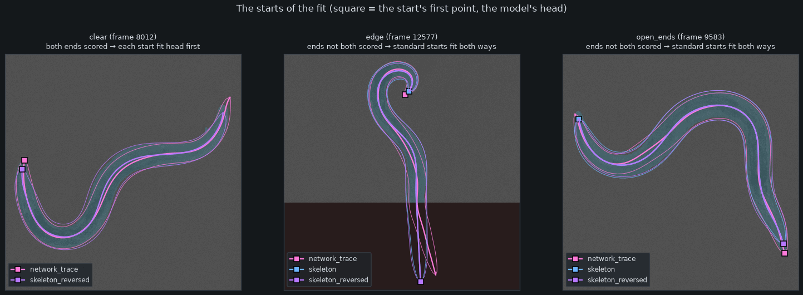

A frame's starts (`pipeline.frame_starts`, `fit_frames`):

| Start | Built from | Name in `best_start` |
|---|---|---|
| trace start | section 5 | `network_trace` |
| skeleton | longest path through the thinned mask (`mask_fit.init_from_skeleton`), lengthened off camera at the border | `skeleton_longest_path` |
| skeleton, other way | the same path traversed from the other end | `skeleton_longest_path_reversed` |
| straight moment arc | the mask's principal axis; stands in when there is no usable skeleton path (the coiled masks here) | `moments_straight[_reversed]` |

Orientation of the standard starts: when **both** ends pass the rules, each
start is fit once, turned so its first and last points lie nearer the
predicted head and tail (clear: one skeleton start, which happens to be the
reversed one). Otherwise it is fit **both ways** and the energy decides
(edge, open_ends). The trace start is always head first when it has a head.

Before fitting, `batch_fit.fit_masks` lays every start from **its own first
point** to the prior's length (`lay_start_to_length`), so a standard start's
first point plays the head's role in the fit, and the reversed start lays its
body from the other end.

The fit stage fits the trace start alone first. Only a frame whose trace
fit reaches IoU < 0.95 (or that has no trace) is also fit from the standard
starts (`TRACE_FIT_IOU`), and the lower energy of the two fits wins. Over the
recording the winner was the trace on 9,737 frames, the skeleton on 5,519,
the reversed skeleton on 4,398 and a moment arc on 42.

## 7. The tube model: midline and outline

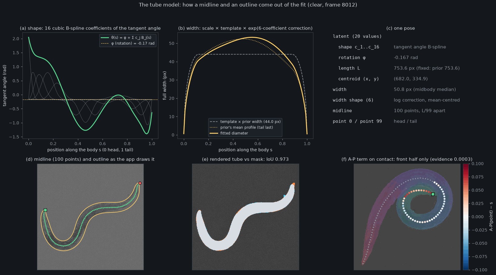

A pose is a **20-value latent** plus a width model (`latent.py`,
`mask_fit._MaskFitState`):

- **Midline.** The tangent angle along the body is
  θ(s) = φ + Σⱼ cⱼ Bⱼ(s), with 16 clamped cubic B-splines Bⱼ over 99
  segments (a). Each segment is L/99 long in direction θ; the points are
  accumulated from point 0 and shifted so their mean is the centroid. So the
  midline is **always 100 points, evenly spaced, exactly L long**, smooth to
  the resolution of 16 coefficients, and point 0 is the head.
- **Width.** The full width at each of the 100 points is
  `width scale × template × exp(correction)` (b): the template is flat with
  elliptical end caps over the last 12% at each end; the correction is a
  6-coefficient B-spline in log space, mean-centred so it changes the shape
  but not the scale, pulled toward the prior's (tail-last) profile.
- **Rendering.** The tube is the union, over the 99 segments, of the region
  within half the (linearly interpolated) width of the segment, with a soft
  edge: occupancy = sigmoid((width/2 − distance) / 0.8 px)
  (`mask_fit.render_tube_segments`). A union means a tip touching the body
  costs nothing, which is what a real contact looks like in a mask.
  Pixels outside the camera are never rendered, so the part of a body off
  camera is unconstrained by the mask: only the length, the width priors
  and the bend limit hold it.
- **Outline.** The app does not draw the rendered tube: it draws both sides
  of the midline offset by half the width along the normals
  (`workspace_draw.drawOutline`, yellow in d). Where the body is straight
  enough the two agree; the fit's IoU is computed on the hard render (> 0.5)
  against the mask (e: white both, orange tube only, cyan mask only).
- **A-P term (f).** Every midline point in the front half samples the A-P
  evidence and is compared with its own position s: a point at s = 0.2
  should sit where the network says 0.2. The rear half is not scored.

## 8. The energy, and which start wins

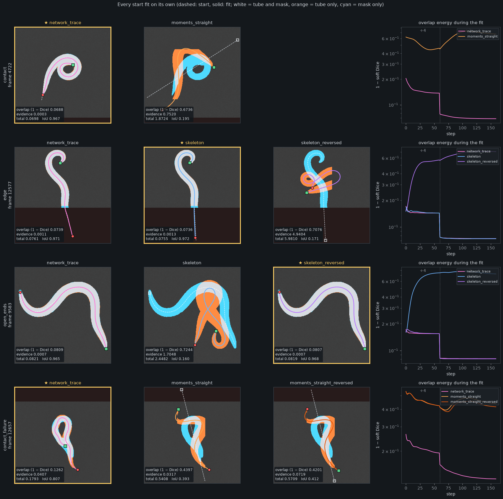

Each start is moved by Adam for 60 steps on the mask block-averaged 4×4,
then 100 steps at 2×2 (`fast` preset); the best iterate of the last stage is
kept, and the final IoU is measured on a full-resolution render. The energy
(`batch_fit._fit_group`, `mask_fit._MaskFitState.regularization`,
`batch_fit._field_penalty`) of the fit stage in this workspace:

| Term | Form | Weight here |
|---|---|---|
| overlap | 1 − soft Dice of rendered tube and mask on the crop | 1 |
| A-P evidence | mean over front-half points of ((A-P(point) − s) / 0.05)² | 0.001 |
| head | (distance of point 0 to the predicted head / 10 px)², when the head passes the rules | 0.01 |
| width scale | ((log w − log 44.0) / 0.05)² | 0.0025 |
| width shape | squared distance of the 6 coefficients from the prior's | 0.01 |
| bend | squared excess of curvature over 1 / (0.5 body widths), summed | 0.002 |
| crop escape | squared distance of points past the crop edges inside the image | 0.001 |
| length | none: fixed at 753.6 px | – |

The **winner** is the start with the lowest total. What the figure shows:

- **contact**: the moment arc cannot find the coil; besides its poor overlap
  it pays 0.75 of evidence (its head is far from the predicted one and its
  front half runs against the A-P field). The trace start, laid from the head
  inside the coil, wins at IoU 0.967.
- **edge**: the trace start and the skeleton reach the same pose (totals
  0.0761 and 0.0755). The reversed skeleton, laid from the off-camera end, is
  pulled toward the head by the end term (evidence 4.94) and collapses.
- **open_ends**: the trace start and the reversed skeleton reach the same
  pose, head on the network's head, totals 0.0821 and 0.0819; the skeleton
  laid from the tail end pays 1.70 of evidence. This frame's stored
  `orientation_gap` is 0.0002: the gap compares the best reversed start with
  the best other start, and here both are head first, so it measures two
  starts agreeing, not an orientation in doubt.
- **contact_failure**: no head, so neither the end term nor the anchored
  trace applies. The trace from the first band wins (IoU 0.807) with its
  head mid-body; the moment arcs do worse.

The evidence is small next to the overlap on a good fit (0.0003 to 0.002
against about 0.07–0.08) and large on a wrong one: it decides between routes
that cover the mask equally, and leaves the edges to the mask.

## 9. What the fit stage stores

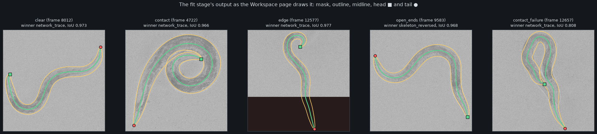

Per frame, in the workspace's `state.npz` (`pipeline.store_result`), and
copied to the `*_independent` arrays so the later stages can replace the
pose and keep the independent fit:

| Array | Meaning |
|---|---|
| `centerline_xy` `[N, 100, 2]` | the midline, point 0 the head, in image pixels (points may lie off camera) |
| `width_profile` `[N, 100]` | full width at each midline point (the outline is drawn from these two) |
| `latent` `[N, 20]`, `width_px`, `width_shape` `[N, 6]` | the model parameters behind them |
| `body_length_px` | L (the prior's, with a fixed length) |
| `iou`, `tube_coverage`, `points_in_fov` | hard render against the mask; midline points in view |
| `energy`, `field_energy`, `total_energy` | the overlap part, the evidence part, and everything |
| `best_start`, `n_starts` | the winning start's name; how many starts were fit |
| `orientation_gap` | best other-orientation total minus the winner's (NaN where the ends fixed the orientation, or only the trace was fit) |
| `taper_asymmetry` | log width of the last 30% minus the first 30% (negative: the tail end is thinner) |

The Workspace page draws exactly these: the Mask layer (key 1), the Midline
with the head square and tail circle (2), the Outline from `centerline_xy`
and `width_profile` (3), and the A-P field of the body model (4).

## 10. Over time: what the per-frame choices do to a sequence

Nothing in sections 1–9 looks at the previous frame. Over a sequence, the
head moves exactly as the network's head peak moves, and the tail moves as
the head plus a fixed-length body happens to land.

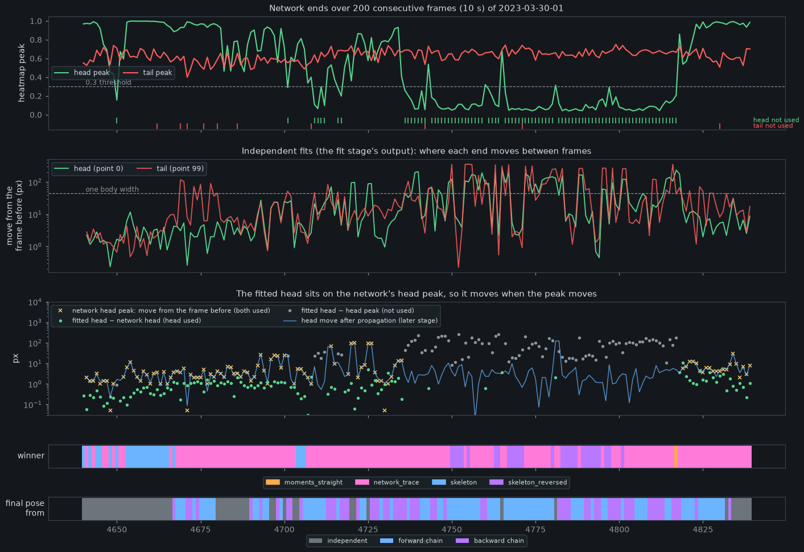

Frames 4640–4839 of the example (the contact frame 4722 is in the middle):

- **The fitted head sits on the network's head.** Wherever the head is used,
  point 0 of the fit lies a median 0.8 px from the heatmap's peak (90th
  percentile 2.1 px; third panel, green dots). The end term (weight 0.01 per
  (10 px)²) and the trace start laid from the head make it so.
- **So the head moves when the peak moves.** Frames 4690–4745 still have a
  head, but the peak steps 20–100 px between frames several times, and the
  fitted head steps with it (yellow line and green dots).
- **The head heatmap can be bimodal, and the argmax picks one mode per
  frame.** Below, frames 4718–4727: the peak alternates between two places
  about 95 px apart (4720, 4721, 4725, 4726), and the fitted midline is laid
  from whichever one won.

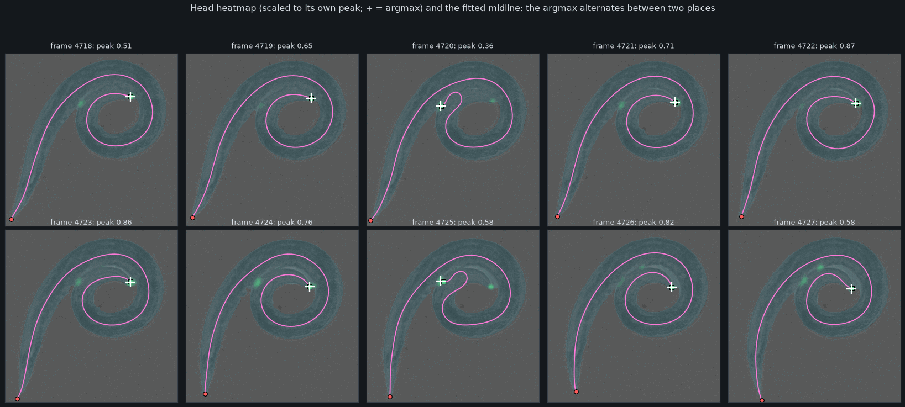

- **The head disappears for long stretches.** From 4745 to 4820 the head
  peak is below 0.3 on all but a handful of frames (first panel): the head is
  inside a coil. The fit then has no anchor, the winner alternates between
  the trace and the reversed skeleton (strip), and the independent fits move by more than
  a body width (44 px) on most frames. In this window the later stages
  replace the independent fit on 146 of 200 frames (bottom strip; blue line
  in the third panel).
- **The tail peak is steadier (0.5–0.7) but the fit does not use it.**

Over all 19,695 consecutive pairs of the recording, independent fits:

| | Head (point 0) | Tail (point 99) |
|---|---|---|
| in view | 99.8% of frames | 42.7% of frames |
| move between frames, median / 90th / 99th percentile | 4.0 / 7.9 / 56.7 px | 11.6 / 164 / 398 px |
| moves over one body width (44 px) | 223 | 5,804 |
| … of those with the tail off camera in either frame | – | 5,304 |
| tail move when in view in both frames, median / 90th / 99th | – | 5.4 / 23.2 / 238 px |
| head and tail swapped relative to the frame before | 70 pairs | |

After the later stages (for comparison only): head moves over a body width
223 → 39, swaps 70 → 12, in-view tail 90th percentile 23.2 → 12.4 px.

Most of the tail's large moves are **off camera**: with the length fixed, the
off-camera part of the body is held only by the bend limit and the
smoothness of the 16-coefficient shape, so its end lands anywhere along a
roughly straight continuation. A tail point off camera is not a measurement; any temporal
score of the tail should look at in-view points only.

### Where the per-frame decisions are made

For testing temporal algorithms, these are the places where a frame's pose
is decided without regard to its neighbours:

| Decision | Where | Effect on a sequence |
|---|---|---|
| head point = argmax of the heatmap | `FieldPrediction.peak` | jumps between the modes of a bimodal heatmap (fig. 10) |
| head used or not (0.3, 20 px off mask, 20 px from edge) | `body_proposal._end`, `_scored` | the anchor switches on and off around the threshold |
| trace route through the bands (nearest patch) | `propose_trace` | the start can take a different turn of a coil from frame to frame |
| standard starts fit only below trace IoU 0.95 | `pipeline.TRACE_FIT_IOU` | which starts compete changes between frames |
| lowest total energy wins | `batch_fit._fit_group` | near ties between different poses pick either |
| length fixed, off-camera body unconstrained | `MaskFitConfig.length_fixed` | off-camera tail swings freely |

## Reproducing the figures

The GPU part runs the network and the fits once on a GPU host and caches
the arrays under the data directory's `runs/fit_layers/`; drawing reads that
cache anywhere:

```bash
# on flv-c3, with an idle GPU (nvidia-smi)
scripts/project_env.sh env CUDA_VISIBLE_DEVICES=1 uv run --no-sync --frozen \
    python scripts/fit_layers_figures.py compute     # about a minute
scripts/project_env.sh uv run --no-sync --frozen python scripts/fit_layers_figures.py render
```

The example frames, the 200-frame window and the flip frames are constants at
the top of the script. The fits are run as the fit stage runs them (the
workspace's stored configuration, the network's fields cropped to the mask)
but with the renderer uncompiled and each start as its own row, so a
re-fit can differ from the stored pose by a pixel and, on a near tie, pick
the other of two equivalent starts (edge: the skeleton instead of the
stored trace start, 0.0755 against 0.0761). Figure 8 draws the stored poses.
